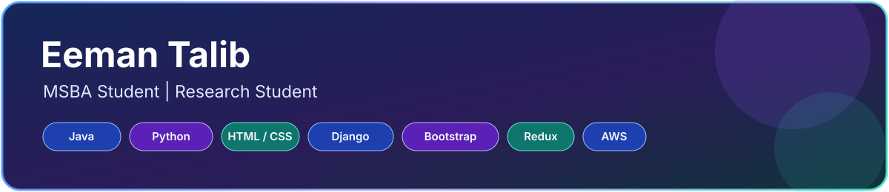
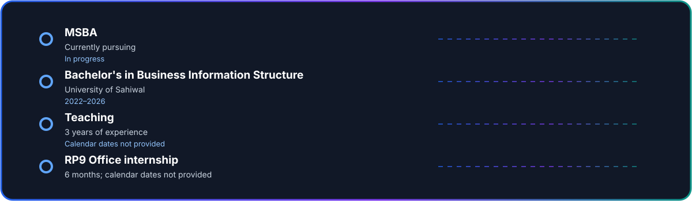

# Eeman Talib

### MSBA Student | Research Student

Currently pursuing an MSBA, with an interest in research, business analytics, technology, and practical IT solutions.

## About Me

I am currently pursuing an MSBA and developing my academic and professional interests in research, business analytics, and technology. I am interested in combining business knowledge with technical skills to understand problems and support effective solutions.

## Experience

| Role / Experience | Details |
|---|---|
| Dental Health Care | Job experience at Dental Health Care, Lahore |
| Teaching | 3 years of teaching experience |
| Freelancing | Freelancing experience |
| Project work | Subway Food Point |
| Research | La Roma, a fast-food chain |
| Internship | RP9 Office — 6 months |
| Small business | Self-owned small startup; customer dealing |
| Internship | Beta Chemical Company, Lahore |
| Invigilation | Invigilation experience |

*Role title, employment dates, and specific responsibilities at Dental Health Care were not provided.*

## Career Timeline

*Only the education period and durations explicitly provided are dated. Dates for other roles were not supplied.*

## What I've Worked On / Projects

- **Subway Food Point** — Project experience.
- **La Roma** — Research involving a fast-food chain.

## Tech Stack

**Programming Languages**

**Frontend**

**Backend**

**Cloud & DevOps**

**Tools & Concepts**

## Core Competencies

| Area | Skills |
|---|---|
| Programming | Java, Python |
| Web development | HTML, CSS, Bootstrap, Django, Redux |
| Cloud | AWS |
| Software model | SaaS |
| Business & productivity | MS Office (Word, Excel, PowerPoint); data entry and management; business software and tools; email and professional communication |
| Analytical | Business process modeling; problem solving; decision making |
| Business | Customer dealing |

## Education & Certifications

| Qualification | Institute | Period / Result |
|---|---|---|
| MSBA | Currently pursuing | In progress |
| Bachelor's in Business Information Structure | University of Sahiwal | 2022–2026 |
| Intermediate in Computer Science (ICS) | Government Women College, Sahiwal | 1st Division |
| Matriculation | Government Girls School, Sahiwal | 1st Division |

**Additional learning:** English Course.

## Research & Achievements

- Research student with an international-level research focus.
- Arts Competition — 1st Position
- Sports Competition — Division Level Medal
- Speech Competition — Shield

## Let's Connect

- **LinkedIn:** [Eeman Talib](https://www.linkedin.com/in/eman-ch-70a041264)

*Thanks for visiting my profile!*

